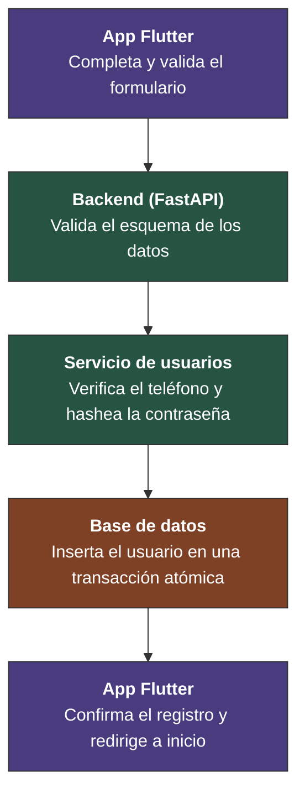
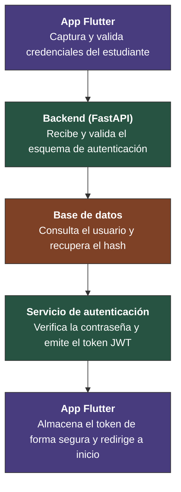
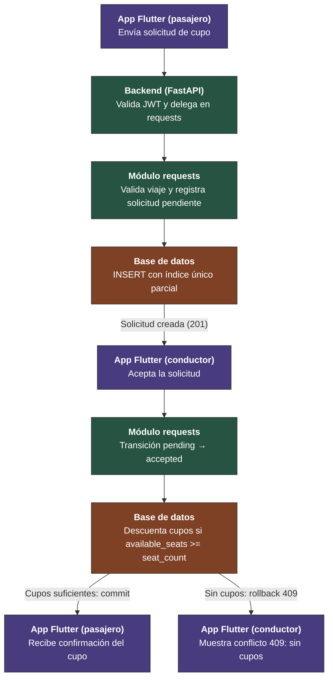

# 6. Vista de ejecución

## 6.1 Escenario de Runtime 1 — Registro de Usuario

Capa de Presentación (Cliente Flutter): el estudiante completa el formulario de registro y la interfaz valida localmente los datos (formato, campos obligatorios, longitud mínima de contraseña) antes de habilitar el envío.

Capa de Red: los datos ya validados se serializan y se transmiten al backend a través de una conexión cifrada, protegiendo la información en tránsito.

Capa de API / Enrutamiento (FastAPI): el backend valida la estructura y el tipo de los datos recibidos contra un esquema estricto, rechazando cualquier solicitud que no cumpla el contrato antes de continuar.

Capa de Servicio (lógica de negocio): se verifica que el teléfono no esté registrado previamente y la contraseña se hashea de forma segura, de modo que el valor original nunca se almacena.

Capa de Persistencia (PostgreSQL / Supabase): el nuevo usuario se inserta en la base de datos dentro de una transacción atómica, garantizando consistencia ante fallos.

Cierre del flujo: el backend confirma la creación del usuario y el cliente redirige al estudiante hacia la pantalla principal, impidiendo el regreso al formulario ya completado.

### Diagrama de secuencia

### Aspectos relevantes

Validación en capas: el cliente filtra errores obvios y el backend impone el contrato final, por lo que ningún dato corrupto llega a persistirse aunque falle la validación del lado del cliente.

Seguridad de credenciales: la contraseña viaja cifrada y se persiste únicamente como hash (bcrypt), nunca en texto plano.

Consistencia transaccional: la inserción en base de datos es atómica, evitando registros parciales si algo falla a mitad de camino.

Experiencia de usuario: la navegación final reemplaza la pantalla de registro en la pila de navegación, evitando que el estudiante repita el proceso por accidente.

## 6.2 Escenario de Runtime 2 — Inicio de Sesión

Capa de Presentación (Cliente Flutter): el estudiante ingresa su número de teléfono y contraseña en la pantalla de inicio de sesión, y la interfaz valida localmente que los campos no se encuentren vacíos y tengan un formato válido antes de procesar el acceso.

Capa de Red: las credenciales ingresadas se empaquetan de forma segura y se transmiten al backend a través de un canal de comunicación cifrado.

Capa de API / Enrutamiento (FastAPI): el backend intercepta la solicitud de acceso y valida la integridad de los datos recibidos contra el esquema de autenticación definido.

Capa de Persistencia (PostgreSQL / Supabase): el sistema consulta la base de datos para recuperar el registro del usuario asociado al número de teléfono y obtener su hash de seguridad.

Capa de Servicio (lógica de negocio): se compara y verifica criptográficamente la contraseña ingresada contra el hash almacenado; una vez confirmada la identidad, el servicio genera y firma digitalmente un token de acceso seguro (JWT) con un tiempo de expiración determinado.

Cierre del flujo: el cliente móvil recibe el token de acceso, lo almacena de forma segura en el dispositivo para autorizar futuras peticiones a la plataforma y redirige al estudiante hacia la pantalla principal, bloqueando el retorno a la vista de inicio de sesión.

### Diagrama de secuencia

### Aspectos relevantes

Arquitectura sin estado (Stateless): el backend no mantiene sesiones activas en memoria ni en base de datos; la identidad y los permisos del estudiante quedan respaldados por la firma digital del token JWT.

Aislamiento de la lógica de autenticación: el módulo de autenticación centraliza la verificación de credenciales y la emisión de tokens, evitando que otros módulos del sistema manejen directamente contraseñas o algoritmos de firma.

Persistencia segura en el cliente: el token se resguarda en el almacenamiento seguro local del dispositivo móvil para adjuntarse como autorización en las solicitudes a módulos como viajes o solicitudes.

Protección en la navegación: al igual que en el registro, la redirección a la pantalla principal reemplaza la vista de inicio de sesión en el historial del dispositivo para evitar accesos redundantes.

---

## 6.3 Escenario de Runtime 3 — Solicitud y aceptación de cupo en un recorrido

Capa de Presentación (Cliente Flutter): el estudiante pasajero selecciona un recorrido disponible y envía una solicitud de cupo (uno o varios asientos, con sus paradas). La interfaz verifica que haya sesión activa y muestra los cupos disponibles antes de enviar.

Capa de Red: la solicitud se transmite con el token JWT del pasajero en la cabecera de autorización, por una conexión cifrada.

Capa de API / Enrutamiento (FastAPI): el backend valida el token, identifica al pasajero y delega en el módulo `requests`. El caso de uso comprueba que el viaje esté activo, que el pasajero no sea el conductor y que no exista otra solicitud activa para ese viaje. La inserción queda protegida por el índice único parcial `uq_trip_requests_active_passenger` (migración 010, ADR 0021); la solicitud nace en estado `pending`.

Capa de Persistencia (PostgreSQL): la solicitud pendiente no descuenta cupos. Cuando el conductor la acepta, el backend ejecuta una transición condicional (`UPDATE … WHERE status = 'pending'`) y, en la misma transacción, descuenta los asientos con `UPDATE … WHERE available_seats >= seat_count`. Si no alcanzan los cupos, la transacción se revierte y responde 409 sin descuento parcial; si otro proceso ganó la carrera, la solicitud se relee y se responde 404 o 409 según su estado. Al aceptar, las demás solicitudes pendientes del pasajero para el mismo día y sentido pasan a `cancelled`.

Cierre del flujo: si la aceptación es exitosa, el pasajero recibe la notificación y la app muestra la solicitud confirmada; si no hay cupos, el conductor ve el conflicto y la solicitud sigue pendiente. La actualización de la ruta con las paradas aceptadas es best-effort y no revierte la aceptación.

### Diagrama de secuencia

### Aspectos relevantes

Atomicidad de la aceptación: la transición de estado, el descuento de cupos y la cancelación de alternativas ocurren en una sola transacción. El descuento usa una actualización condicional, de modo que dos aceptaciones concurrentes no pueden consumir el mismo cupo ni dejar valores negativos.

Idempotencia de la solicitud: el índice único parcial impide dos solicitudes activas del mismo pasajero para el mismo viaje incluso con envíos simultáneos; la API responde 400 con el contrato existente.

Respuesta inmediata: cada paso recibe su respuesta en la misma conexión HTTP (ADR 0004).

Protección frente a concurrencia: `backend/tests/test_requests_concurrency.py` cubre aceptaciones simultáneas sobre cupos limitados, creaciones duplicadas, aceptar frente a retirar/rechazar y grupos sin cupos. `backend/tests/test_cupos.py` conserva la medición p95 < 3,99 s del camino atómico de reserva (ADR 0003).

Autorización por rol: solo el conductor dueño del viaje puede aceptar o rechazar; solo el pasajero dueño puede retirar. El módulo de autenticación valida el token antes de llegar al módulo `requests`.

---
