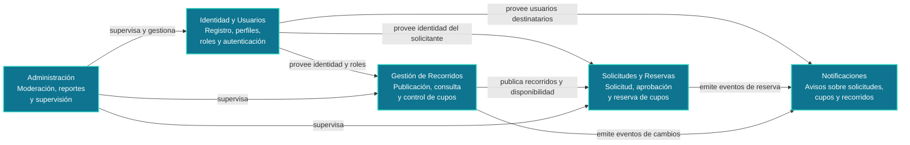
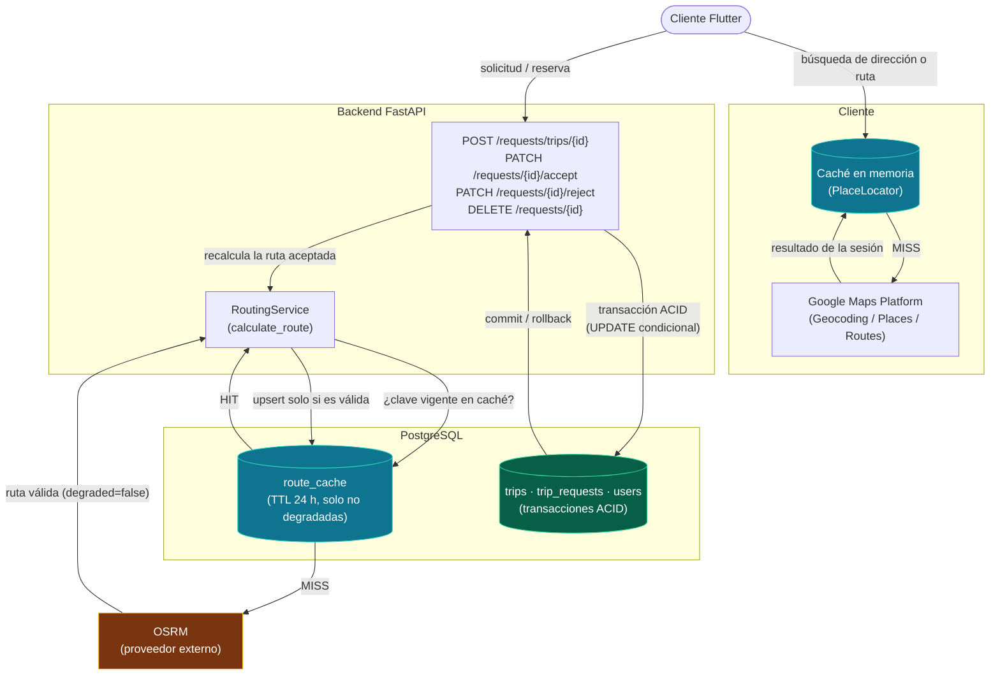

# 8. Conceptos transversales

Los conceptos transversales son decisiones y mecanismos que afectan a varios
módulos y funcionalidades de ROUTB. Se describen de forma independiente de la
implementación concreta para mantener una visión arquitectónica común.

## 8.1 Lenguaje ubicuo técnico

Esta sección define los términos técnicos que deben entender de la misma forma
las personas que trabajan en el proyecto.

| Concepto técnico | Qué significa en ROUTB | Dónde se refleja |
|---|---|---|
| Backend | Aplicación que contiene las reglas del negocio y expone la funcionalidad de ROUTB. | FastAPI en `backend/app/`. |
| Frontend | Aplicación con la que interactúan los estudiantes y administradores. | Flutter en `frontend/lib/`. |
| API | Punto de comunicación entre frontend y backend. | Endpoints FastAPI que reciben y devuelven JSON. |
| Módulo | Unidad funcional dentro del backend monolítico. | `users`, `auth`, `trips`, `matching`, `requests`, `notifications` y `admin`. |
| Capa | Tipo de responsabilidad dentro de un módulo. | `router` expone la API, `service` aplica reglas, `models` representa datos y `schemas` valida mensajes. |
| Autenticación | Verificación de la identidad antes de permitir una operación protegida. | `/auth/login`, JWT y `get_current_user`. |
| Autorización | Decisión sobre qué operaciones puede ejecutar una identidad autenticada. | Roles del usuario y dependencias de seguridad del backend. |
| Token JWT | Credencial firmada que el backend entrega después del inicio de sesión. | Backend genera el token; Flutter conserva `routb_access_token` en `SharedPreferences`. |
| Persistencia | Conservación de los datos aunque la API o la aplicación se reinicien. | PostgreSQL en Supabase, SQLAlchemy y los modelos ORM. |
| ORM | Mapeo entre clases del código y tablas de la base de datos. | `User` → `users` y `Trip` → `trips`. |
| Migración | Cambio versionado del esquema de la base de datos. | Alembic en `backend/migrations/`. |
| Transacción atómica | Operación que se confirma completa o se revierte completa. | Reserva de cupo mediante actualización condicionada en `trips`. |
| Integración externa | Comunicación con un sistema que no pertenece al código de ROUTB. | Servicios de mapas y notificaciones push. |
| Contrato de error | Formato y significado de las respuestas cuando una operación falla. | Códigos HTTP, `detail` de FastAPI y `AuthApiException` en Flutter. |

## 8.2 Mapa de contextos funcionales

ROUTB se organiza en contextos funcionales dentro de un único backend
modular. Un contexto agrupa una responsabilidad del negocio y define los
términos y reglas que le corresponden. Estos contextos no son servicios
desplegables independientes.

| Contexto | Responsabilidad | Relación principal |
|---|---|---|
| Identidad y Usuarios | Registrar usuarios, mantener perfiles, roles y autenticación. | Provee identidad y permisos a los demás contextos. |
| Gestión de Recorridos | Publicar recorridos y mantener la disponibilidad de cupos. | Expone recorridos y disponibilidad a Solicitudes y Reservas. |
| Solicitudes y Reservas | Gestionar solicitudes y confirmar reservas sin sobrepasar los cupos. | Consume recorridos y emite eventos de reserva. |
| Notificaciones | Informar solicitudes, reservas, cambios y disponibilidad. | Recibe eventos de Recorridos y Solicitudes y los entrega a los usuarios. |
| Administración | Supervisar usuarios, recorridos y solicitudes, además de gestionar reportes. | Consulta y gestiona los demás contextos según permisos administrativos. |

En el código actual, Identidad y Usuarios corresponde a `users` y `auth`;
Gestión de Recorridos a `trips` y `matching`; Solicitudes y Reservas a
`requests`; Notificaciones a `notifications`; y Administración a `admin`.

---

## 8.3 Gestión de secretos y configuración

Para garantizar que ningún dato sensible o credencial de infraestructura quede expuesto en el repositorio de código, ROUTB implementa una política estricta de configuración desacoplada:

1. **Entorno local:** Las variables sensibles (`DATABASE_URL`, `JWT_SECRET_KEY`) se cargan desde un archivo `backend/.env` que está ignorado de forma permanente por Git (`.gitignore`).
2. **Plantilla de configuración (`.env.example`):** Se versiona un archivo de ejemplo con las claves requeridas y valores no sensibles (placeholders), facilitando que cualquier desarrollador configure su entorno sin exponer datos de producción.
3. **Integración continua (CI):** En GitHub Actions, los secretos necesarios para pruebas se inyectan a través de GitHub Secrets o variables de entorno temporales aisladas en el job de prueba.
4. **Entorno de producción:** En la plataforma de hosting (Dokploy), los secretos se gestionan mediante el panel de variables de entorno del servicio, impidiendo su almacenamiento en texto plano en el repositorio.

## 8.4 Observabilidad y logging estructurado

El backend implementa logging estructurado en formato JSON a través de un middleware HTTP en FastAPI (`backend/app/main.py`), canalizado hacia la salida estándar (`stdout`):

- **Formato estándar:** Cada registro emite un objeto JSON con campos explícitos: `timestamp` (ISO 8601 UTC), `method`, `path`, `status_code`, `duration_ms` y `client_ip`.
- **Cobertura automática:** Aplica transversalmente a todos los endpoints del sistema, incluyendo `/health` y las operaciones de negocio (`/users`, `/trips`, `/auth`, `/requests`).
- **Compatibilidad cloud:** La salida a `stdout` permite que el recolector de logs de Dokploy ingiera y presente los eventos sin requerir agentes pesados ni servicios de terceros de pago.

## 8.5 Degradación controlada ante fallo de proveedores externos

Cuando Google Maps u OSRM no responden, ROUTB degrada sin romperse (ADR 0018 y ADR 0014):

- **Timeout único configurable:** `ROUTING_TIMEOUT_SECONDS` (1,4 s por defecto) limita cada llamada al routing del backend. El cliente de Google usa su propio timeout de 8 s y no bloquea la interfaz.
- **Respaldo en el cliente:** si Google no responde, el buscador usa el catálogo local de barrios y el mapa dibuja la curva estimada. No se reintroduce Nominatim ni OSRM en Flutter.
- **Respaldo tipado del backend:** el ruteo responde `200` con ruta geodésica marcada `degraded=true`; nunca `500` por un fallo externo.
- **Caché solo válida:** los resultados `degraded` no se persisten ni se sirven desde caché, para no ocultar la recuperación del proveedor.
- **Sin reintentos automáticos:** reintentar multiplicaría la latencia de cada petición y pondría en riesgo el umbral de 3,99 s.

## 8.6 Tabla de operaciones y garantías de consistencia

Esta tabla mapea cada operación real del sistema a su mecanismo de garantía y al código que lo implementa. Cubre tanto el flujo crítico de solicitudes/cupos como la caché de geocodificación del cliente y la caché de rutas del backend.

| Operación | Archivo de implementación | Mecanismo de garantía | Garantía efectiva |
|---|---|---|---|
| **Aceptar solicitud y reservar cupos** | `backend/app/modules/requests/application/manage_request.py` (`accept_request`) | `UPDATE … WHERE status='pending'` con `rowcount == 1`; `reserve_request_seats` en la misma transacción; `db.rollback()` si la reserva falla; si la transición pierde, relee y responde 404/409 (ADR 0021) | Atomicidad ACID: ambas partes ocurren o ninguna; 0 % de sobreventa bajo concurrencia |
| **Rechazar solicitud y liberar cupos** | `backend/app/modules/requests/application/manage_request.py` (`reject_request`) | `UPDATE … WHERE status=old_status`; `release_request_seats` solo si el estado anterior era `accepted`; `db.rollback()` si la liberación falla | Atomicidad ACID: liberación ocurre entera o no ocurre; cupos nunca se liberan dos veces |
| **Crear solicitud (idempotencia ante duplicado)** | `backend/app/modules/requests/application/create_request.py` y `backend/migrations/versions/010_solicitud_activa_unica.py` | Chequeo previo + índice único parcial `uq_trip_requests_active_passenger` sobre `(trip_id, passenger_id) WHERE status IN ('pending','accepted')`; `IntegrityError` se traduce a 400 | Consistencia: nunca dos solicitudes activas del mismo pasajero en el mismo viaje, incluso con peticiones simultáneas |
| **Retirar solicitud y liberar cupos** | `backend/app/modules/requests/application/manage_request.py` (`withdraw_request`) | `DELETE … RETURNING`; si `removed is None` → `db.rollback()` + 404 | Idempotencia: segunda llamada retorna 404 sin doble liberación de cupos |
| **Cancelar solicitudes alternativas al aceptar** | `backend/app/modules/requests/application/manage_request.py` (`accept_request`) | `UPDATE … WHERE status='pending' AND trip_id IN (…)` en la misma transacción que la aceptación | Consistencia: el pasajero no puede quedar con dos solicitudes aceptadas el mismo día y sentido |
| **Caché de geocodificación (cliente)** | `frontend/lib/core/map/place_locator.dart` | Mapa en memoria por consulta normalizada; si Google no responde se usa el catálogo local de barrios; no se persiste ni se comparte entre sesiones | Solo caché de sesión: ROUTB no almacena consultas de direcciones; una nueva sesión vuelve a consultar al proveedor (ADR 0018) |
| **Caché de rutas del backend (`route_cache`)** | `backend/app/shared/routing/service.py` | TTL de 24 h con intervalo parametrizado; llave SHA-256 de coordenadas redondeadas a 5 decimales; solo se persisten y sirven rutas OSRM con `degraded=false`; purga con `RETENTION_CACHE_DAYS` | Consistencia temporal: nunca se sirve una ruta degradada; una caída del proveedor se reintenta en la siguiente solicitud |

## 8.7 Estrategia integrada de consistencia e invalidación de caché

ROUTB maneja dos dominios de datos con requisitos de consistencia completamente distintos. Esta sección explica cómo se articulan sin interferirse.

### Dominio 1: datos de negocio (solicitudes y cupos)

- **Modelo:** consistencia estricta (ACID) vía transacciones PostgreSQL locales.
- **Mecanismo:** actualización condicional en SQL (`UPDATE … WHERE`) + `db.commit()` o `db.rollback()` atómicos. Ningún resultado de negocio pasa por caché.
- **Invariante garantizada:** `available_seats` en la tabla `trips` nunca cae por debajo de cero ni refleja una reserva que no se haya confirmado. Cualquier concurrencia se resuelve en la base de datos, no en la aplicación.
- **Referencia:** [ADR 0003](../adr/0003-control-atomico-de-cupos.md), [ADR 0017](../adr/0017-decision-extraccion-modulo-requests.md).

### Dominio 2: geocodificación en el cliente y caché de rutas

La resolución de direcciones y la caché de rutas viven en capas distintas:

- **Geocodificación (cliente Flutter).** Google Maps Platform resuelve dirección
  a coordenada, coordenada a dirección y autocompletado (ADR 0018). `PlaceLocator`
  guarda en memoria las respuestas de la sesión (`_geocodeCache`) y las geometrías
  de ruta (`_routeCache`); no hay persistencia ni caché de geocodificación en
  PostgreSQL. Si Google no responde o no hay clave, se usa el catálogo local de
  barrios y la curva estimada, sin reintroducir Photon ni Nominatim.
- **Caché de rutas del backend (`route_cache`).** El cálculo de rutas del backend
  usa OSRM y conserva únicamente resultados reales (`degraded=false`) durante
  24 horas. La llave es el SHA-256 de las coordenadas redondeadas a 5 decimales.
  Las rutas de respaldo geodésicas no se guardan ni se sirven desde caché, de modo
  que una caída transitoria de OSRM se reintenta en la siguiente petición
  (ADR 0014). La purga de privacidad usa `RETENTION_CACHE_DAYS` (ADR 0011).
- **Invalidación.** En el cliente, la caché se descarta al terminar la sesión o
  al llamar a `clearCache()` en pruebas. En el backend, las entradas caducan por
  TTL y se reemplazan con un upsert (`ON CONFLICT ... DO UPDATE`) cuando OSRM
  devuelve una ruta válida.
- **Referencias:** [ADR 0018](../adr/0018-google-maps-platform-frontend.md),
  [ADR 0014](../adr/0014-fallback-geocode-cache.md),
  [ADR 0011](../adr/0011-consentimiento-y-privacidad-de-ubicacion.md) y
  `backend/app/shared/routing/service.py`.

### Separación de dominios (sin interferencia)

Los cupos **nunca** pasan por una caché. La caché de geocodificación vive en la
memoria del cliente y la de rutas en la tabla `route_cache` del backend; los
cupos se resuelven siempre en tiempo real con actualizaciones condicionales y
transacciones ACID sobre `trips` y `trip_requests` (ADR 0003 y ADR 0021).

**Clave de lectura del diagrama:**
- El camino de mapas del cliente (azul) usa Google Maps con caché en memoria de la sesión; no pasa por el backend.
- El camino de solicitudes/cupos (verde) va directo a la base de datos con garantía ACID; **no existe caché intermedia**.
- El camino de rutas del backend (azul) usa `route_cache` con TTL de 24 h y descarta los resultados degradados antes del upsert.
