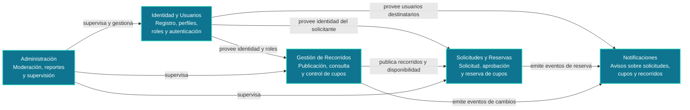
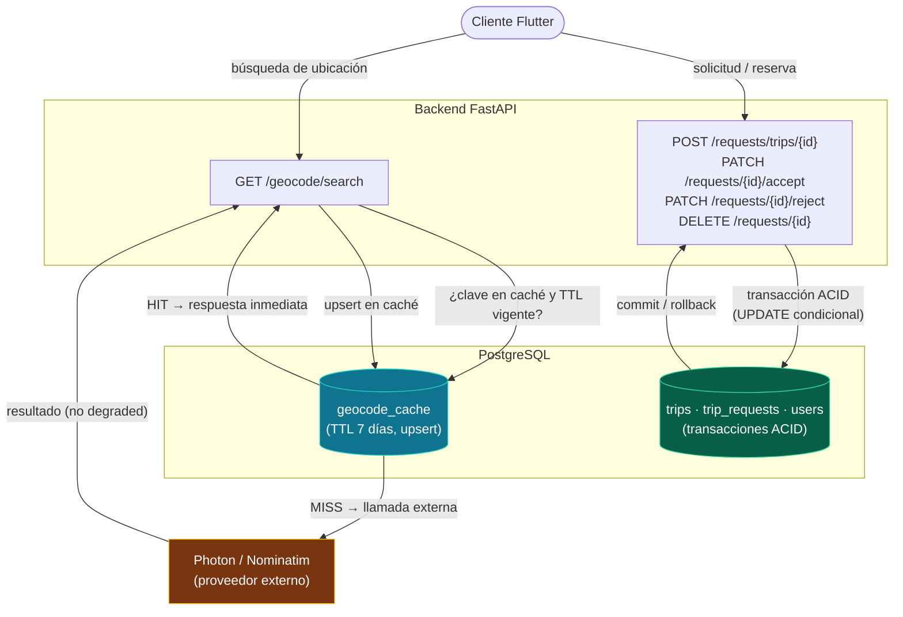

# 8. Conceptos transversales

Los conceptos transversales son decisiones y mecanismos que afectan a varios
módulos y funcionalidades de ROUTB. Se describen de forma independiente de la
implementación concreta para mantener una visión arquitectónica común.

## 8.1 Lenguaje ubicuo técnico

Esta sección define los términos técnicos que deben entender de la misma forma
las personas que trabajan en el proyecto.

| Concepto técnico | Qué significa en ROUTB | Dónde se refleja |
|---|---|---|
| Backend | Aplicación que contiene las reglas del negocio y expone la funcionalidad de ROUTB. | FastAPI en `backend/app/`. |
| Frontend | Aplicación con la que interactúan los estudiantes y administradores. | Flutter en `frontend/lib/`. |
| API | Punto de comunicación entre frontend y backend. | Endpoints FastAPI que reciben y devuelven JSON. |
| Módulo | Unidad funcional dentro del backend monolítico. | `users`, `auth`, `trips`, `requests`, `notifications` y `admin`. |
| Capa | Tipo de responsabilidad dentro de un módulo. | `router` expone la API, `service` aplica reglas, `models` representa datos y `schemas` valida mensajes. |
| Autenticación | Verificación de la identidad antes de permitir una operación protegida. | `/auth/login`, JWT y `get_current_user`. |
| Autorización | Decisión sobre qué operaciones puede ejecutar una identidad autenticada. | Roles del usuario y dependencias de seguridad del backend. |
| Token JWT | Credencial firmada que el backend entrega después del inicio de sesión. | Backend genera el token; Flutter conserva `routb_access_token` en `SharedPreferences`. |
| Persistencia | Conservación de los datos aunque la API o la aplicación se reinicien. | PostgreSQL en Supabase, SQLAlchemy y los modelos ORM. |
| ORM | Mapeo entre clases del código y tablas de la base de datos. | `User` → `users` y `Trip` → `trips`. |
| Migración | Cambio versionado del esquema de la base de datos. | Alembic en `backend/migrations/`. |
| Transacción atómica | Operación que se confirma completa o se revierte completa. | Reserva de cupo mediante actualización condicionada en `trips`. |
| Integración externa | Comunicación con un sistema que no pertenece al código de ROUTB. | Servicios de mapas y notificaciones push. |
| Contrato de error | Formato y significado de las respuestas cuando una operación falla. | Códigos HTTP, `detail` de FastAPI y `AuthApiException` en Flutter. |

## 8.2 Mapa de contextos funcionales

ROUTB se organiza en contextos funcionales dentro de un único backend
modular. Un contexto agrupa una responsabilidad del negocio y define los
términos y reglas que le corresponden. Estos contextos no son servicios
desplegables independientes.

| Contexto | Responsabilidad | Relación principal |
|---|---|---|
| Identidad y Usuarios | Registrar usuarios, mantener perfiles, roles y autenticación. | Provee identidad y permisos a los demás contextos. |
| Gestión de Recorridos | Publicar recorridos y mantener la disponibilidad de cupos. | Expone recorridos y disponibilidad a Solicitudes y Reservas. |
| Solicitudes y Reservas | Gestionar solicitudes y confirmar reservas sin sobrepasar los cupos. | Consume recorridos y emite eventos de reserva. |
| Notificaciones | Informar solicitudes, reservas, cambios y disponibilidad. | Recibe eventos de Recorridos y Solicitudes y los entrega a los usuarios. |
| Administración | Supervisar usuarios, recorridos y solicitudes, además de gestionar reportes. | Consulta y gestiona los demás contextos según permisos administrativos. |

En el código actual, Identidad y Usuarios corresponde a `users` y `auth`, y
Gestión de Recorridos corresponde a `trips`. Los contextos de Solicitudes y
Reservas, Notificaciones y Administración están definidos arquitectónicamente,
pero sus entidades y casos de uso todavía se encuentran en desarrollo.

---

## 8.3 Gestión de secretos y configuración

Para garantizar que ningún dato sensible o credencial de infraestructura quede expuesto en el repositorio de código, ROUTB implementa una política estricta de configuración desacoplada:

1. **Entorno local:** Las variables sensibles (`DATABASE_URL`, `JWT_SECRET_KEY`) se cargan desde un archivo `backend/.env` que está ignorado de forma permanente por Git (`.gitignore`).
2. **Plantilla de configuración (`.env.example`):** Se versiona un archivo de ejemplo con las claves requeridas y valores no sensibles (placeholders), facilitando que cualquier desarrollador configure su entorno sin exponer datos de producción.
3. **Integración continua (CI):** En GitHub Actions, los secretos necesarios para pruebas se inyectan a través de GitHub Secrets o variables de entorno temporales aisladas en el job de prueba.
4. **Entorno de producción:** En la plataforma de hosting (Dokploy), los secretos se gestionan mediante el panel de variables de entorno del servicio, impidiendo su almacenamiento en texto plano en el repositorio.

## 8.4 Observabilidad y logging estructurado

El backend implementa logging estructurado en formato JSON a través de un middleware HTTP en FastAPI (`backend/app/main.py`), canalizado hacia la salida estándar (`stdout`):

- **Formato estándar:** Cada registro emite un objeto JSON con campos explícitos: `timestamp` (ISO 8601 UTC), `method`, `path`, `status_code`, `duration_ms` y `client_ip`.
- **Cobertura automática:** Aplica transversalmente a todos los endpoints del sistema, incluyendo `/health` y las operaciones de negocio (`/users`, `/trips`, `/auth`, `/requests`).
- **Compatibilidad cloud:** La salida a `stdout` permite que el recolector de logs de Dokploy ingiera y presente los eventos sin requerir agentes pesados ni servicios de terceros de pago.

## 8.5 Degradación controlada ante fallo de proveedores externos

Cuando Google Maps u OSRM no responden, ROUTB degrada sin romperse (ADR 0018 y ADR 0014):

- **Timeout único configurable:** `ROUTING_TIMEOUT_SECONDS` (1,4 s por defecto) limita cada llamada al routing del backend. El cliente de Google usa su propio timeout de 8 s y no bloquea la interfaz.
- **Respaldo en el cliente:** si Google no responde, el buscador usa el catálogo local de barrios y el mapa dibuja la curva estimada. No se reintroduce Nominatim ni OSRM en Flutter.
- **Respaldo tipado del backend:** el ruteo responde `200` con ruta geodésica marcada `degraded=true`; nunca `500` por un fallo externo.
- **Caché solo válida:** los resultados `degraded` no se persisten ni se sirven desde caché, para no ocultar la recuperación del proveedor.
- **Sin reintentos automáticos:** reintentar multiplicaría la latencia de cada petición y pondría en riesgo el umbral de 3,99 s.

## 8.6 Tabla de operaciones y garantías de consistencia

Esta tabla mapea cada operación real del sistema a su mecanismo de garantía y al código que lo implementa. Cubre tanto el flujo crítico de solicitudes/cupos como la caché de geocodificación.

| Operación | Archivo de implementación | Mecanismo de garantía | Garantía efectiva |
|---|---|---|---|
| **Aceptar solicitud y reservar cupos** | `backend/app/modules/requests/application/manage_request.py:77–94` | `UPDATE … WHERE status='pending'` con `rowcount == 1`; `reserve_request_seats` en la misma transacción; `db.rollback()` si la reserva falla | Atomicidad ACID: ambas partes ocurren o ninguna; 0 % de sobreventa bajo concurrencia |
| **Rechazar solicitud y liberar cupos** | `backend/app/modules/requests/application/manage_request.py:170–187` | `UPDATE … WHERE status=old_status`; `release_request_seats` solo si el estado anterior era `accepted`; `db.rollback()` si la liberación falla | Atomicidad ACID: liberación ocurre entera o no ocurre; cupos nunca se liberan dos veces |
| **Crear solicitud (idempotencia ante duplicado)** | `backend/app/modules/requests/application/create_request.py:58–68` | Chequeo previo de existencia de solicitud activa `(trip_id, passenger_id)` en estado `pending` o `accepted` antes de insertar | Consistencia: nunca dos solicitudes activas del mismo pasajero en el mismo viaje |
| **Retirar solicitud y liberar cupos** | `backend/app/modules/requests/application/manage_request.py:217–235` | `DELETE … RETURNING`; si `removed is None` → `db.rollback()` + 404 | Idempotencia: segunda llamada retorna 404 sin doble liberación de cupos |
| **Cancelar solicitudes alternativas al aceptar** | `backend/app/modules/requests/application/manage_request.py:97–120` | `UPDATE … WHERE status='pending' AND trip_id IN (…)` en la misma transacción que la aceptación | Consistencia: el pasajero no puede quedar con dos solicitudes aceptadas el mismo día y sentido |
| **Caché de geocodificación (lectura)** | `backend/app/modules/geocode/` | Consulta `geocode_cache` por clave normalizada y TTL vigente antes de llamar al proveedor externo | Consistencia temporal: se sirven coordenadas vigentes; nunca coordenadas degradadas desde caché |
| **Caché de geocodificación (escritura)** | `backend/app/modules/geocode/` | Upsert (`ON CONFLICT … DO UPDATE`) con nueva coordenada y marca de tiempo | Invalidación por reemplazo: una geocodificación nueva de la misma consulta desplaza la entrada anterior |

## 8.7 Estrategia integrada de consistencia e invalidación de caché

ROUTB maneja dos dominios de datos con requisitos de consistencia completamente distintos. Esta sección explica cómo se articulan sin interferirse.

### Dominio 1: datos de negocio (solicitudes y cupos)

- **Modelo:** consistencia estricta (ACID) vía transacciones PostgreSQL locales.
- **Mecanismo:** actualización condicional en SQL (`UPDATE … WHERE`) + `db.commit()` o `db.rollback()` atómicos. Ningún resultado de negocio pasa por caché.
- **Invariante garantizada:** `available_seats` en la tabla `trips` nunca cae por debajo de cero ni refleja una reserva que no se haya confirmado. Cualquier concurrencia se resuelve en la base de datos, no en la aplicación.
- **Referencia:** [ADR 0003](../adr/0003-control-atomico-de-cupos.md), [ADR 0017](../adr/0017-decision-extraccion-modulo-requests.md).

### Dominio 2: caché de geocodificación

- **Modelo:** consistencia eventual con ventana configurable de 7 días (`RETENTION_CACHE_DAYS`).
- **Política de invalidación:**
  1. **Por expiración (TTL):** las entradas caducan automáticamente transcurridos `RETENTION_CACHE_DAYS` días desde su última escritura.
  2. **Por escritura/upsert:** una nueva geocodificación exitosa de la misma consulta normalizada reemplaza la entrada anterior (`ON CONFLICT … DO UPDATE`); la caché nunca acumula versiones antiguas de la misma clave.
  3. **Por resultado degradado:** los resultados marcados `degraded=true` no se persisten (§8.5), garantizando que la caché no sirva coordenadas de respaldo como si fueran válidas.
  4. **Sin sincronización con OSM/Photon:** ROUTB no rastrea actualizaciones del mapa base en tiempo real; la expiración por TTL cubre la coherencia eventual con la fuente geográfica.
- **Referencia:** [ADR 0010](../adr/0010-geocodificacion-y-cache.md), [ADR 0014](../adr/0014-fallback-geocode-cache.md), [Evidencia: Política de invalidación de caché](../evidencia/politica-invalidacion-cache-geocode.md).

### Separación de dominios (sin interferencia)

Los cupos **nunca** pasan por la caché de geocodificación. Ambos dominios comparten la misma base de datos PostgreSQL pero usan tablas y flujos independientes: la caché solo afecta a la latencia de búsqueda de ubicaciones, mientras que la consistencia de cupos se resuelve siempre en tiempo real con bloqueos a nivel de fila.

**Clave de lectura del diagrama:**
- El camino de geocodificación (azul) pasa por caché con TTL e invalidación por upsert.
- El camino de solicitudes/cupos (verde) va directo a la base de datos con garantía ACID; **no existe caché intermedia**.
- Los resultados degradados del proveedor externo (naranja) se descartan antes del upsert.
